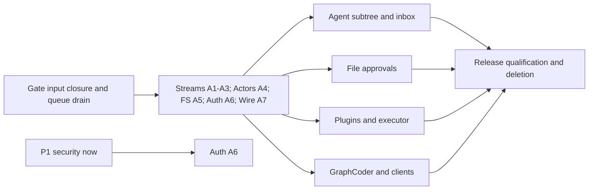

# Redesign schedule - Codex

Endpoint2026-10-26T01:17:54.197315Z. Critical path: exact-main input closure + gate-speed1509 -> Wave1 barrier (longest owner ETA unknown) -> Wave2 -> full release qualification/deletion lane.

Top blocker: Shared pre-dispatch input-closure admission and verified queue drain; owner readiness/PR identities not yet supplied.

Observed service rate4 merges/day; 6.0h/merge. Eleven minimum service slots imply 66.0h after proof readiness. This is a conditional queue-only floor, not total delivery ETA. Owner readiness is missing; unconditional forecasts are unknown.

|Scope|Lane/state|Redesign PR|Conditional service-only date floor|Top blocker / existing predecessors|
|---|---|---|---|---|
|P1 security|b-authority: owner activity unverified|unknown|2026-10-26T13:17:54.197315Z|Owner must identify source PR, proof-ready checkpoint and remaining dependency work; legacy PRs are not assumed redesign delivery. Legacy [1510]|
|A1+A2+A3|streams: owner activity unverified|unknown|2026-10-26T19:17:54.197315Z|Owner must identify source PR, proof-ready checkpoint and remaining dependency work; legacy PRs are not assumed redesign delivery. Legacy []|
|A4|b-runtime: owner activity unverified|unknown|2026-10-27T01:17:54.197315Z|Owner must identify source PR, proof-ready checkpoint and remaining dependency work; legacy PRs are not assumed redesign delivery. Legacy [1512]|
|A5|fs-concurrency: owner activity unverified|unknown|2026-10-27T07:17:54.197315Z|Owner must identify source PR, proof-ready checkpoint and remaining dependency work; legacy PRs are not assumed redesign delivery. Legacy [1492]|
|A6|b-authority: owner activity unverified|unknown|2026-10-27T13:17:54.197315Z|Owner must identify source PR, proof-ready checkpoint and remaining dependency work; legacy PRs are not assumed redesign delivery. Legacy [1510]|
|A7|client-perf: owners active; readiness unverified|unknown|2026-10-27T19:17:54.197315Z|Owner must identify source PR, proof-ready checkpoint and remaining dependency work; legacy PRs are not assumed redesign delivery. Legacy [1508]|
|wave2 agent subtree/inbox|sessions+b-runtime: owner activity unverified|unknown|2026-10-28T01:17:54.197315Z|Owner must identify source PR, proof-ready checkpoint and remaining dependency work; legacy PRs are not assumed redesign delivery. Legacy [1512, 1500]|
|wave2 file approvals|approvals: owners active; readiness unverified|unknown|2026-10-28T07:17:54.197315Z|Owner must identify source PR, proof-ready checkpoint and remaining dependency work; legacy PRs are not assumed redesign delivery. Legacy [1511]|
|wave2 plugins/executor|plugins: owners active; readiness unverified|unknown|2026-10-28T13:17:54.197315Z|Owner must identify source PR, proof-ready checkpoint and remaining dependency work; legacy PRs are not assumed redesign delivery. Legacy [1507]|
|wave2 GraphCoder/client deletions|client-perf: owners active; readiness unverified|unknown|2026-10-28T19:17:54.197315Z|Owner must identify source PR, proof-ready checkpoint and remaining dependency work; legacy PRs are not assumed redesign delivery. Legacy [1508]|

|Queued PR|Conditional merge date if proof-ready now|Current top blocker|
|---|---|---|
|#1509|2026-10-26T07:17:54.197315Z|Full frozen-head gate/review proof and queue custody; inspect current held/baseline state.|
|#1495|2026-10-26T13:17:54.197315Z|Full frozen-head gate/review proof and queue custody; inspect current held/baseline state.|
|#1504|2026-10-26T19:17:54.197315Z|Full frozen-head gate/review proof and queue custody; inspect current held/baseline state.|
|#1508|2026-10-27T01:17:54.197315Z|Full frozen-head gate/review proof and queue custody; inspect current held/baseline state.|
|#1512|2026-10-27T07:17:54.197315Z|Full frozen-head gate/review proof and queue custody; inspect current held/baseline state.|

Current queued PRs: [1509, 1495, 1504, 1508, 1512]. Owner checkpoint and PR identity requests sent directly; no queued/sent line counts as merged progress.

- No owner completion ETAs yet: unconditional merge dates and final delivery date are unknown.
- Date floors assume proof-ready immediately, unchanged observed throughput and one gate prerequisite plus ten redesign PRs; coding, legacy predecessors, blocked reviews, security scope splits and final acceptance can add time.
- Wave1 APIs are parallel as approved; Wave2 uses the full Wave1 barrier conservatively until owners prove narrower dependencies.
- Legacy open PR ownership is branch-name metadata, not proof those PRs implement the new redesign scope.
